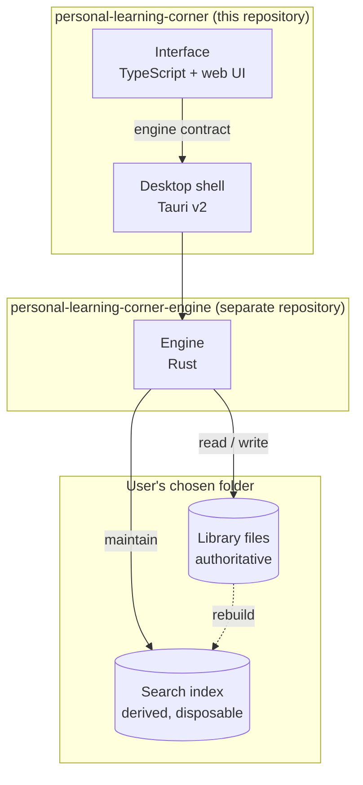

# Architecture

> **Audience:** People building Personal Learning Corner
> **Status:** In progress — M0 implemented
> **Last reviewed:** 2026-09-28

## Principles

These are load-bearing. A design that violates one of them is wrong, however convenient it
is.

1. **Local-first, and local-only.** No account, no server, no telemetry. Every feature must
   work on a machine that has never been online. Anything requiring a network is optional,
   clearly marked, and degrades to a manual path.
2. **Files are the source of truth.** Everything the user creates is a readable file in a
   folder they chose. Any index we keep is derived, disposable, and rebuildable from those
   files alone. See [ADR 0003](adr/0003-files-as-source-of-truth.md).
3. **Never destroy user data.** No operation overwrites or discards user content without an
   explicit decision. Where the system cannot determine intent, it stops and asks. The
   rejected copy is retained. See [Backup and synchronisation](backup-and-sync.md).
4. **Provenance is the product.** The application exists because information is abundant and
   unverifiable. Sources are therefore first-class entities with structured fields, not
   formatted strings inside a document, and the link from a claim to its source is modelled
   explicitly. Any feature that makes it easier to record an unsourced assertion than a
   sourced one is working against the product.
5. **The library outlives the application.** A user's folder must remain useful if this
   project is abandoned. This forbids opaque containers, proprietary compression, and any
   format whose meaning lives only in our code.

## Shape of the system

Three pieces, two repositories.

**Interface** — the web UI, running in the shell's webview. Renders, handles input, and calls
the engine. It holds no durable state: everything it displays came from an engine call and
everything it changes goes back through one. Losing the interface process loses nothing.

**Desktop shell** — Tauri v2. Owns the window, the menus, the file dialogs, the second window
for mind maps, and the packaging. It is glue, not logic. The one thing it keeps for itself
between runs is the list of libraries this computer has opened, which lives in the
application's settings rather than in any library
([Packaging](packaging-fedora.md#directories)).

**Engine** — Rust, in [its own repository](repositories.md). Owns the library: reading and
writing files, maintaining the index, parsing and formatting citations, aligning parallel
texts, and running backup comparison. Every rule about the user's data lives here, and it is
usable without any interface at all — which is what makes it testable and what makes a future
command-line or mobile client possible.

See [ADR 0001](adr/0001-tauri-rust-stack.md) for why this stack, and
[ADR 0002](adr/0002-separate-backend-repository.md) for why the engine is a separate
repository.

## Where logic is allowed to live

The boundary is the thing most likely to erode, so state it plainly:

| Concern | Engine | Interface |
| ------- | :----: | :-------: |
| Reading and writing library files | ✅ | ❌ |
| Deciding what a valid citation is | ✅ | ❌ |
| Formatting an APA 7 reference string | ✅ | ❌ |
| Segmenting and aligning parallel text | ✅ | ❌ |
| Comparing library against backup, detecting conflicts | ✅ | ❌ |
| Search | ✅ | ❌ |
| Which panes are visible, pane order, layout | ❌ | ✅ |
| Map node positions | ✅ (persisted) | ✅ (dragging) |
| Undo/redo | ✅ | ❌ |
| Window management, dialogs, menus | ❌ | ✅ (shell) |
| Which libraries this computer has opened | ❌ | ✅ (shell) |

The rule of thumb: **if getting it wrong could corrupt or lose a user's library, it belongs
in the engine.** The interface is allowed to be wrong about pixels, never about data.

The formatting row deserves emphasis. It is tempting to format references in the interface,
where the display is. Don't — it puts a correctness-critical, heavily-specified body of rules
([citation model](citation-model.md)) somewhere it cannot be property-tested against
fixtures, and duplicates it the moment a second client exists.

## How a change travels

Writing a sentence and citing a source:

1. Interface calls the engine with the document identifier and the new content.
2. Engine writes the document file, atomically — write to a temporary file in the same
   directory, then rename over the target. A crash mid-write leaves either the old file or
   the new one, never a truncated one.
3. Engine updates the derived index for that document.
4. Engine returns the saved state; the interface renders it.

There is no in-memory document that is more current than the file on disk. The file is the
state. This is what makes external editing safe, makes crash recovery trivial, and makes the
backup comparison meaningful.

## What the engine watches

The engine watches the library folder for changes made outside the application, because
[the user is explicitly permitted to edit their files](../user/libraries-and-files.md). On an
external change it re-reads the affected files and refreshes the index. If a document is open
in the interface and unmodified there, it reloads; if it has local modifications, the user is
asked — the same never-destroy rule as everywhere else.

## Deliberate non-goals

Recorded so they are not accidentally reintroduced:

- **No sync service.** Multi-machine use is a deliberate, reviewed copy via a drive.
  See [ADR 0003](adr/0003-files-as-source-of-truth.md).
- **No collaborative editing.** Single user, single writer. This assumption is load-bearing
  for the storage format and the conflict model.
- **No plugin system**, until the data model has stopped moving. Plugins freeze whatever
  they touch.
- **No rich page layout.** Documents are for learning, not typesetting. Export handles
  presentation.
- **No cloud, no account, no telemetry** — ever, not "not yet".

## Related

- [Stack](stack.md) — what we build with, and what is excluded
- [Engine contract](backend-contract.md) — the operations across the boundary
- [Storage format](storage-format.md) — what the engine writes
- [Roadmap](roadmap.md) — what gets built, in what order
